# Trajectory Cleaning Model Report

Generated: 2026-07-18; updated: 2026-10-31 (R019 retraining and R020 promotion; R019 CNN is production)

## Purpose

The `trajectory_cleaning` module labels every observation in a mother-machine
cell trajectory using only time and cell spine length. A trajectory is identified
by `trajectory_key`, and its rows are sorted by time before normalization and
model inference.

The model produces two independent outputs at every time point:

1. `division_point`: the observation marks a cell-division event.
2. `excluded_point`: the observation is noise or should be excluded.

These are multi-label outputs rather than mutually exclusive classes. A point
may be labeled as both division and excluded, which occurs in the example data.

## Architecture comparison

The following values use the current default `ModelConfig`: five input features
(the extended layout described under "Inputs and normalization"), two outputs,
64 hidden channels/units, four layers, kernel size 5, and dropout 0.15.
Parameter counts for the legacy two-channel layout (pre-R002 checkpoints) are
given in parentheses.

| Property | 1D CNN | 1D ResNet | Bidirectional LSTM |
|---|---:|---:|---:|
| Trainable parameters | 63,938 (62,978) | 165,890 (165,698) | 334,594 (333,058) |
| Approximate FP32 weight memory | 0.24 MiB | 0.63 MiB | 1.27 MiB |
| Default temporal context | 17 points | 121 points | Entire trajectory |
| Future context used | Yes | Yes | Yes by default |
| Sequence computation | Fully parallel | Fully parallel | Recurrent/sequential |
| Relative training speed | Fastest | Fast | Slowest |
| Main strength | Local changes and compact size | Local and cell-cycle-scale patterns | Flexible full-history context |
| Main risk | Context may be too short | More parameters than plain CNN | Highest overfitting risk on this dataset |

Weight-memory estimates include parameters only, assuming 32-bit floating-point
weights. Training also requires memory for activations, gradients, and optimizer
state.

### 1D CNN

Implementation: `CNNLabeler` in `models.py`.

The CNN consists of four default convolution blocks. Each block contains:

- a centered 1D convolution;
- channel-wise layer normalization at each time point;
- GELU activation;
- dropout.

A final `1 x 1` convolution maps the hidden representation to the two output
logits. With four layers and kernel size 5, its receptive field is:

```text
1 + num_layers * (kernel_size - 1) = 17 time points
```

The centered convolutions allow a prediction to see observations before and
after the target point. This is particularly useful because a division label is
placed on the mother observation immediately before the daughter-length drop.

The CNN is the smallest and fastest option. It is suitable when division and
noise decisions are dominated by local length changes. Its limitation is that
17 points may not cover an entire cell cycle.

### 1D ResNet

Implementation: `ResNetLabeler` and `ResidualBlock` in `models.py`.

The ResNet first projects the two inputs to 64 channels. It then applies four
residual blocks by default. Each block contains two centered convolutions, and
the dilation pattern is `1, 2, 4, 8`. The residual connection helps gradients
flow through the deeper model.

Its default receptive field is:

```text
1 + 2 * (kernel_size - 1) * sum(1, 2, 4, 8) = 121 time points
```

This covers essentially all of a typical 120-point trajectory in the example
dataset. The ResNet can therefore combine the immediate division drop with the
longer growth pattern without recurrent computation.

This is the recommended default model. It offers substantially more context
than the plain CNN, remains parallelizable, and has roughly half as many
parameters as the default bidirectional LSTM.

### Bidirectional LSTM

Implementation: `LSTMLabeler` in `models.py`.

The default LSTM has four recurrent layers, 64 hidden units per direction, and a
bidirectional output. A dropout layer and linear projection convert its hidden
state at every time point into the two logits.

Variable-length trajectories are processed with packed sequences. Padding is
therefore excluded from recurrent state updates. Because the model is
bidirectional, every prediction may use the full past and future trajectory.

The LSTM offers the most flexible global sequence context, but it is the largest
and slowest architecture. With only 103 labeled example trajectories, it also
has the greatest overfitting risk. Setting `bidirectional=False` produces a
past-only LSTM, although the current normalization still uses the complete
trajectory and is intended for offline analysis.

The `kernel_size` setting does not affect the LSTM. Conversely, the
`bidirectional` setting does not affect the CNN or ResNet.

## Inputs and normalization

Implementation: `TrajectoryNormalizer` and `TrajectoryDataset` in `data.py`.

Since round R002 the default input is the five-channel "extended" layout
(`feature_compatibility="extended"`, canonical channel names in
`FEATURE_COLUMNS`):

```text
[batch, time_points, 5]  — channels: time, length, length_delta,
                                     log_growth_rate, time_since_last_drop
```

Checkpoints trained before round R002 declare `feature_compatibility="legacy"`
and receive the original two-channel `[batch, time_points, 2]` (time, length)
layout, so their loaded behavior is unchanged.

All channels are computed independently per trajectory from only the selected
time column and `spine_length`; no fluorescence or other morphology columns are
used. Every channel is finally clipped to [-12, 12] (`clip_value`; [0, 12] for
`time_since_last_drop`) and cast to float32. A trajectory must contain at least
two time points, and time must be finite and strictly increasing after sorting.

### Channel 1 — `time`

Within each trajectory:

```text
sampling_interval = median of the positive consecutive time differences
frame_time        = (time - first_time) / sampling_interval
time              = frame_time / 100        # time_step_scale
```

Consequences:

- seconds, hours, and days produce identical feature values (unit invariance);
- adding a constant acquisition timestamp offset changes nothing;
- skipped frames remain visible as jumps in `frame_time`;
- one sampling interval corresponds to 0.01 feature units, so the channel reads
  in units of 100 frames.

### Channel 2 — `length`

```text
ratio        = spine_length / median(positive spine_lengths)
log_ratio    = log(max(ratio, 1e-6))        # epsilon floor
center       = median(log_ratio over positive lengths)
robust_scale = 1.4826 * MAD(log_ratio)      # mad_consistency
               fallback 1: (Q75 - Q25) / 1.349   if MAD ~ 0
               fallback 2: std(log_ratio)        if IQR ~ 0
               floor: max(robust_scale, 0.05)    # minimum_length_scale
length       = (log_ratio - center) / robust_scale
```

Consequences:

- multiplying all lengths by a constant (µm vs pixels, magnification changes,
  systematic growth-condition shifts) leaves the feature unchanged;
- the trajectory median is the reference, so the channel measures growth
  relative to that cell line's own typical size;
- MAD-based scaling limits the influence of isolated extreme values;
- a division that halves the cell length contributes approximately
  `-log(2) / robust_scale`, a fixed-size step regardless of absolute size.

Nonpositive spine lengths trigger a `RuntimeWarning` and are mapped through the
epsilon floor toward the negative clip bound; their labels are never rewritten
by the normalizer. The Streamlit preflight (below) keeps such rows out of model
input entirely, and the corpus builder records them as omitted invalid rows.

### Channels 3-5 — boundary-safe dynamics (added in round R002)

The pre-R002 two-channel layout encoded only *absolute* position in the
experiment. On long trajectories the `time` channel extrapolates beyond the
training range, which collapsed late-trajectory division recall (the R002 root
cause: tail recall 0.086 with the legacy checkpoint). The three added channels
are computed from the *unclipped* length feature so the division signature is
stationary with respect to absolute experiment time:

```text
length_delta[t]       = length_feature[t] - length_feature[t-1]   (first point: 0)
log_growth_rate[t]    = length_delta[t] / max(frame_time[t] - frame_time[t-1], 1)
time_since_last_drop  = (frame_index - index of most recent t with length_delta <= -1) / 100
                        (no previous drop -> counts from just before the first frame)
```

- `length_delta` exposes the division drop directly in normalized units — a
  halving division is a step of about `-log(2) / robust_scale` wherever it
  occurs in the trajectory;
- `log_growth_rate` is the per-frame elongation slope and is robust to
  irregular sampling because its denominator is clamped to at least one frame;
- `time_since_last_drop` encodes cell-cycle phase without absolute time, using
  strong drops (`length_delta <= -1`) as internal boundary markers.

### Normalization scope and causality

The normalization is performed independently for every trajectory and has no
learned global statistics — the normalizer is a plain constants record
(`epsilon`, `mad_consistency`, `clip_value`, `time_step_scale`,
`minimum_length_scale`, `feature_compatibility`), so nothing is fitted on the
training corpus and checkpoints only store these constants. It uses the
complete sequence, so it is appropriate for offline cleaning. A real-time
system would require running normalization based only on past observations.

### Streamlit inference preflight

Before an AI preview or autopilot inference, the Streamlit app validates every
candidate observation. A point is invalid when time is nonfinite, spine length
is nonfinite or nonpositive, or its otherwise usable timestamp is an ambiguous
duplicate of another usable point. Finite negative and zero time offsets remain
valid because normalization subtracts the first retained time.

Invalid observations remain in the raw trajectory and, when their coordinates
are plottable, remain visible as applied exclusions so they can be restored or
edited manually. The app forces them into the applied exclusions, omits them
from trajectory normalization and model scoring, and identifies their export
rows with
`ai_prediction_source=validation_rule`. Scored valid rows use
`ai_prediction_source=model`. A trajectory with fewer than two valid points
cannot be inferred and requires manual curation or corrected input data.
The statistics layer also defensively omits nonfinite/nonpositive feature rows
before an AI run so a malformed current trajectory can still open; this does
not add an exclusion label until preflight runs.

## Padding and masks

Trajectories may have different lengths. `collate_trajectories` pads each batch
and creates a Boolean validity mask.

- CNN and ResNet activations are masked after each convolutional stage so padded
  points cannot contaminate valid predictions.
- LSTM inputs use packed sequences.
- The training loss ignores every padded point.

The resulting output shape is always:

```text
[batch, time_points, 2]
```

## Training properties

Implementation: `TrainConfig`, `MaskedFocalBCEWithLogitsLoss`, and `train_model`
in `training.py`.

Default training configuration:

| Setting | Default |
|---|---:|
| Epochs | 100 |
| Batch size | 16 trajectories |
| Optimizer | AdamW |
| Learning rate | 0.001 |
| Weight decay | 0.0001 |
| Focal-loss gamma | 1.5 |
| Maximum positive-class weight | 50 |
| Early-stopping patience | 15 epochs |
| Random seed | 42 |
| Device | CUDA when available, otherwise CPU |

Division and exclusion losses are calculated independently. Positive-class
weights are estimated from the training trajectories as `negative / positive`
and capped at 50. Focal weighting further reduces the influence of easy negative
points. This is important because the example data contains approximately 5.4%
division points and only 0.73% excluded points.

The optimizer clips gradient norm to 5.0. Early stopping restores the state with
the lowest validation loss.

## Splitting and leakage control

`split_trajectory_keys` assigns complete `trajectory_key` groups to training,
validation, and test partitions. The default proportions are approximately
70%, 15%, and 15%.

Rows from one trajectory are never divided between partitions. The splitter
also attempts to balance exclusion presence and division-event count when the
number of trajectories permits stratification.

Trajectory grouping prevents direct row-level leakage. The example trajectories
come from a small number of FOVs, however, so a stricter leave-one-FOV-out test
would provide a better estimate of performance on new experiments or growth
conditions.

## Thresholds and evaluation

The model returns raw logits. A sigmoid converts each output independently to:

```text
P(division_point), P(excluded_point)
```

Separate thresholds are selected on validation data to maximize point-level F1
for each label.

Reported point metrics include:

- support;
- precision;
- recall;
- F1;
- average precision (PR-AUC).

Division-event evaluation collapses consecutive division-positive points into a
single biological event. A non-excluded labeled point is preferred as the true
event representative, and the highest division probability represents a
predicted run. Events are matched one-to-one within the configured tolerance,
which defaults to one frame.

### Raw labels and effective division boundaries

Division and exclusion remain independent raw labels and are never rewritten by
conflict resolution. For cycle analysis, a contiguous raw division run produces
at most one effective boundary. An all-excluded run coalesces onto an already
established previous valid division. If no such boundary exists, it shifts to
the nearest previous non-excluded point only when the valid-neighbor length
ratio is strictly `next / previous < 0.75`; missing or invalid neighbors and
ratios of 0.75 or greater require manual review and produce no boundary.

Each raw division source receives `unchanged`, `coalesced_previous`,
`shifted_previous`, or `needs_review`. The app displays review cases as orange
downward triangles. Statistics and exported `cell_cycle_index` use
`effective_division_point`, while `division_point` and `excluded_point` preserve
the raw annotations.

Labeled CSVs record `division_effective_target_index`, `division_resolution`,
`division_previous_valid_index`, `division_next_valid_index`, and
`division_length_ratio` for audit. On the labeled example, all 36 overlapping
division/exclusion rows were checked: 31 coalesced onto an existing previous
division, five remained `needs_review`, and zero were shifted. Across the full
dataset, 668 raw division sources resolve to 631 effective boundaries: 631
sources are unchanged, 32 are coalesced, five need review, and none are shifted.

When `Merge Cycles` spans multiple selected boundaries, it removes the earlier
selected division boundaries but preserves the latest selected point when that
point is an existing division boundary. This protection applies whether the
latest boundary is raw, an effective target, or the target of one or more
coalesced sources, so merging does not silently discard the selected terminal
cycle boundary.

### Applied exclusion display and restoration

Applied exclusions are non-destructive annotations. Each remains visible as a
marker-only red X named `Applied exclusion`, but is omitted from statistics,
growth fits, and connected spine and fluorescence lines. Both line types split
at every exclusion instead of connecting observations across it. Manual and
AI-applied exclusions have the same applied-state semantics.

`↩️ Restore Selected Exclusions` restores only selected applied markers;
`🔄 Reset All Exclusions` restores all exclusions while retaining current
division labels; and `🗑️ Reset All` also reinstates the original divisions.
The separate `AI exclusion` marker is a pending preview and can reappear after a
manual restore until the preview is cleared or replaced. For selectability on
the logarithmic spine plot, nonpositive excluded lengths use a positive display
fallback while hover text preserves the original value.
Nonfinite-time rows cannot have a meaningful plot x-coordinate, so the right
panel lists invalid AI input IDs and provides a per-ID restore control. Restored
invalid rows are excluded again at the next inference unless their values are
corrected.

## Initial example dataset limitations

The example CSV contains 12,332 points from 103 trajectories:

- 668 division-positive points;
- 90 exclusion-positive points;
- 36 points positive for both labels;
- one zero-length point, which is invalid under the stricter Streamlit
  inference preflight.

Division learning is supported by several events in every trajectory. Noise
learning is much less certain because only 48 trajectories contain any excluded
points and the 90 labels may not represent every segmentation failure mode.
Increasing the diversity and number of manually labeled excluded points is more
likely to improve noise detection than increasing model size.

The zero-length training observation should be reviewed and either corrected or
explicitly excluded before retraining. Future data cleanup and checkpoint
retraining should reconcile the training corpus with the stricter UI inference
rule rather than relying on the normalizer's finite-floor fallback.

## Initial trained baseline (2026-07-15)

All three default architectures were trained with seed 42, batch size 16, up to
100 epochs, and patience 15. The split kept complete `trajectory_key` groups
together and contained 72 training, 16 validation, and 15 test trajectories.
Thresholds were calibrated independently on validation point F1.

| Model | Parameters | Epochs (best) | Best validation loss | Division / noise threshold | Validation division-event F1 | Validation noise F1 | Test division-event F1 | Test noise F1 |
|---|---:|---:|---:|---:|---:|---:|---:|---:|
| CNN | 62,978 | 56 (41) | 0.0334 | 0.84 / 0.92 | 0.990 | 0.750 | 0.989 | 0.933 |
| ResNet | 165,698 | 22 (7) | 0.0802 | 0.90 / 0.77 | 0.975 | 0.444 | 0.968 | 0.400 |
| Bidirectional LSTM | 333,058 | 40 (25) | 0.0790 | 0.80 / 0.61 | 0.980 | 0.241 | 0.967 | 0.150 |

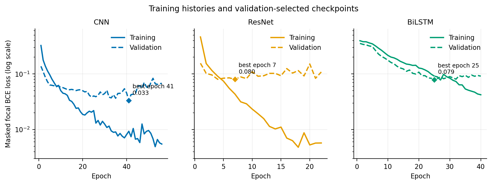

*Figure 1. Training and validation loss on a logarithmic scale. Diamonds mark
the minimum-validation-loss state restored into each checkpoint. CNN validation
loss continued improving through epoch 41, while ResNet and BiLSTM reached
their selected states at epochs 7 and 25.*

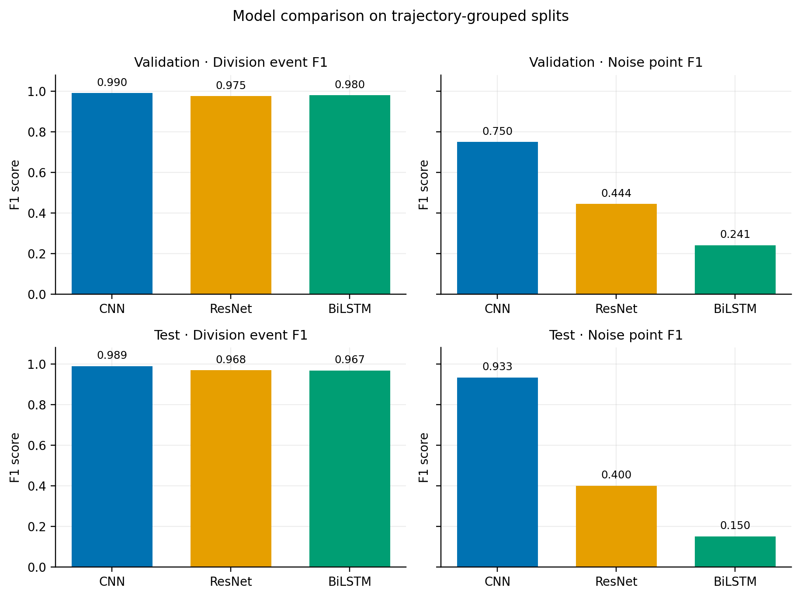

*Figure 2. Division-event and excluded-point F1 on validation and test data.
Division detection is consistently strong across architectures. The CNN has a
substantially better noise-label F1 and is therefore the validation-selected
model.*

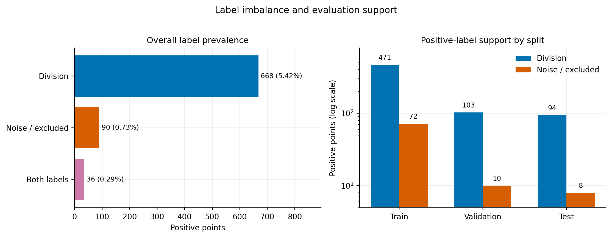

*Figure 3. Label prevalence and positive support in the fixed seed-42 split.
Only 10 validation and 8 test points are labeled as excluded, so the apparently
high CNN test noise F1 has considerable sampling uncertainty.*

The CNN was selected using validation results and promoted to
`../trajectory_cleaning_run/best_model.pt`. The architecture-specific artifacts
remain in the `cnn`, `resnet`, and `lstm` subdirectories. A full-data inference
smoke test produced finite predictions for all 12,332 rows.

These values are an initial engineering baseline, not a final biological
validation. Channels from the same FOV occur in more than one split, so shared
acquisition conditions may make the metrics optimistic. Validation and test
contain only 10 and 8 excluded points respectively. The source data also have
36 overlapping division/exclusion labels and one unexcluded zero-length point.
The baseline training normalizer mapped that point to a finite floor, whereas
the current Streamlit preflight excludes it from model scoring; the next data
cleanup and retraining cycle should remove this policy mismatch.

## Human-verified multi-condition retraining (2026-07-17)

### Corpus and label provenance

The retraining corpus was built from the two explicitly listed CSV files in
`LineageAnalysis/trajectories_data`. Supervision comes only from the final
canonical `division_point` and `excluded_point` columns. Every `pred_*`,
`ai_*`, `effective_*`, division-resolution, and audit field is excluded from
the prepared CSV and therefore cannot become a training target.

The new starvation CSV contains AI audit values for 3,000 rows, but its final
division annotations disagree with those predictions on 293 rows: five
human-final divisions were absent from the AI labels and 288 AI divisions were
removed. This confirms that prediction columns are not interchangeable with the
verified final annotations. The coincidental agreement between final and AI
exclusion labels in this file does not change the target-selection policy.

| Source | Raw rows | Retained rows | Trajectories | Division points | Excluded points | Both labels |
|---|---:|---:|---:|---:|---:|---:|
| 0-8 h baseline | 12,332 | 12,331 | 103 | 668 | 90 | 36 |
| 2025-11-11 starvation | 3,300 | 3,300 | 11 | 58 | 69 | 0 |
| **Combined** | **15,632** | **15,631** | **114** | **726** | **159** | **36** |

The folder's baseline CSV is byte-identical to the earlier example training
file and is counted only once. Source SHA-256 values are
`eb8b675b20855cb0b98f6300126da48fddb99f37a90afaf520631fc2da5b3e8d`
and
`2ca7cc8cf2f408b02ad9e7ac2f3e6e5fba07092510c215abbe56dc446308a5f4`.
Three raw trajectory names occur in both experiments, so prepared keys use
`<source_dataset>::<source_trajectory_key>`. The single baseline row with
`spine_length=0` is omitted as invalid input and recorded in the manifest; its
verified labels are not edited.

The reproducible prepared CSV and provenance record are
`../trajectory_cleaning_run/verified_20260717/verified_training_data.csv` and
`../trajectory_cleaning_run/verified_20260717/dataset_manifest.json`.
The manifest records the user's human-verification attestation, full source
hashes, ignored audit fields, collision handling, and invalid-row disposition.

### Fixed trajectory-grouped split

All architectures use the same seed-42 split. Complete namespaced trajectories
remain together, and both experiments appear in every partition.

| Split | Trajectories | Rows | Division points | Excluded points | Baseline / starvation trajectories |
|---|---:|---:|---:|---:|---:|
| Training | 80 | 11,019 | 512 | 111 | 72 / 8 |
| Validation | 17 | 2,220 | 106 | 24 | 16 / 1 |
| Test | 17 | 2,392 | 108 | 24 | 15 / 2 |

This prevents direct trajectory leakage, but it is not an experiment-held-out
evaluation. Channels from the same FOV or condition can occur in multiple
partitions, so FOV-grouped cross-validation remains the preferred next
biological generalization study.

### Retrained architecture comparison

The default architecture and optimizer settings are unchanged from the initial
baseline. Early stopping restores minimum validation loss, and output thresholds
are calibrated independently on validation point F1. Architecture selection
uses only the arithmetic mean of validation division-event F1 and validation
excluded-point F1; test metrics do not participate.

| Model | Parameters | Epochs (best) | Best validation loss | Division / exclusion threshold | Validation division-event F1 | Validation exclusion F1 | Validation mean F1 | Test division-event F1 | Test exclusion F1 |
|---|---:|---:|---:|---:|---:|---:|---:|---:|---:|
| **CNN** | 62,978 | 43 (28) | 0.0311 | 0.83 / 0.80 | 0.990 | 0.764 | **0.877** | 0.977 | 0.596 |
| ResNet | 165,698 | 36 (21) | 0.0346 | 0.77 / 0.75 | 0.986 | 0.706 | 0.846 | 0.972 | 0.508 |
| Bidirectional LSTM | 333,058 | 79 (64) | 0.0450 | 0.75 / 0.79 | 0.986 | 0.545 | 0.765 | 0.986 | 0.500 |

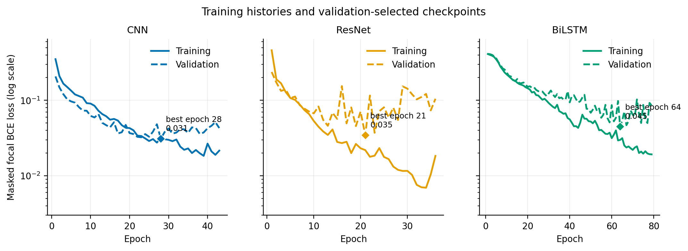

*Figure 4. Retraining histories. Diamonds identify the restored
minimum-validation-loss epoch for each architecture.*

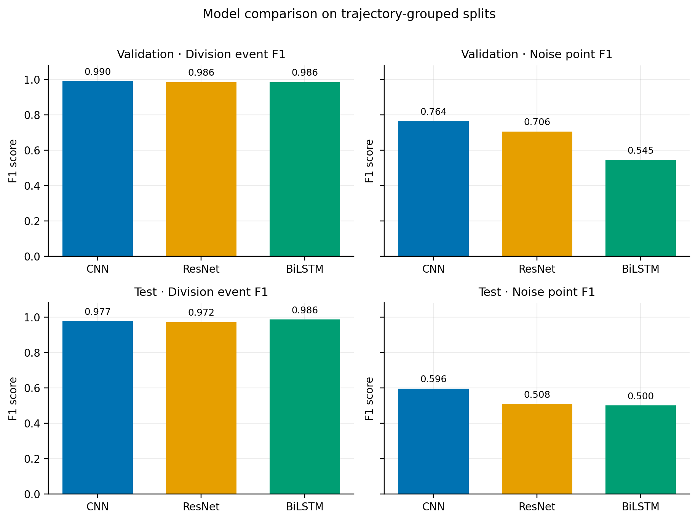

*Figure 5. Validation and held-out test F1 for division events and excluded
points. CNN is selected from validation results only.*

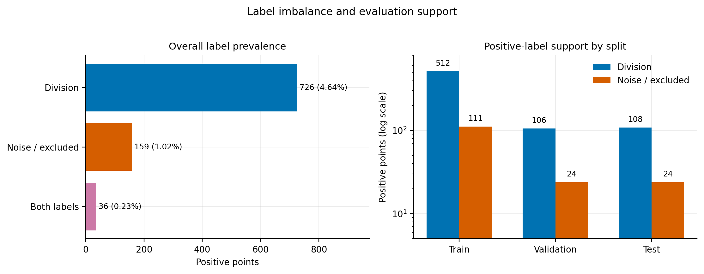

*Figure 6. Canonical-label prevalence and positive support in the fixed
trajectory-grouped split. Validation and test each contain 24 excluded points,
compared with 10 and 8 in the initial run.*

For the selected CNN, source-specific results provide useful context:

| Partition and source | Trajectories | Division support | Exclusion support | Division-event F1 | Exclusion F1 |
|---|---:|---:|---:|---:|---:|
| Validation, baseline | 16 | 101 | 16 | 0.990 | 0.757 |
| Validation, starvation | 1 | 5 | 8 | 1.000 | 0.778 |
| Test, baseline | 15 | 96 | 11 | 0.989 | 0.700 |
| Test, starvation | 2 | 12 | 13 | 0.889 | 0.519 |

The aggregate CNN test exclusion F1 of 0.596 should not be compared directly
with the initial 0.933 value: the old test contained only eight excluded points,
whereas the new test contains 24 and includes a more difficult starvation
condition. The source-specific starvation estimates are themselves uncertain
because only one validation and two test trajectories represent that condition.

CNN won the validation-only comparison and was promoted to
`../trajectory_cleaning_run/best_model.pt`. The active checkpoint SHA-256 is
`ebb3f53f4bb2c7db0e27b80bcf43ff2b0d6014abde3240043f76de67105ed7b4`.
Its checkpoint metadata embeds the verified dataset manifest and training CSV
hash. The previous deployment and companion artifacts were backed up under
`../trajectory_cleaning_run/promotion_backups/20260717T065922.061193Z`;
the selection rationale and artifact hashes are recorded in
`../trajectory_cleaning_run/promotion.json`.

## Expanded 0-10 h verified retraining (2026-07-18)

### New source audit and overlap policy

The added `0-10h_selected_labeled.csv` contains 71,586 rows from 479
trajectories, with 4,012 final division labels, 657 final exclusion labels, and
168 points carrying both labels. Its saved AI suggestions disagree with the
human-final annotations at 128 division points and 155 exclusion points. As in
the previous run, only the final canonical `division_point` and
`excluded_point` columns are permitted to become targets.

The 0-10 h export is an expanded revision of part of the 0-8 h source rather
than an independent experiment. The two files share 83 trajectory keys and
9,935 observations that match one-to-one by trajectory and cell index, with
identical time and spine length. Among those observations, the newer review
changes 19 division labels and 16 exclusion labels. The corpus builder therefore
uses the explicit precedence rule `baseline_0_8h=baseline_0_10h`: a shared
0-8 h trajectory is omitted in full, while the 20 genuinely old-only
trajectories are retained. This avoids duplicating observations and ensures that
the newer verified annotations win.

Thirty-six rows in the new source and one retained old-only row have zero spine
length. All 36 invalid new rows are final exclusions. They are recorded in the
manifest and omitted from model input without editing the source CSV or
silently changing any label.

| Retained source | Rows | Trajectories | Division points | Excluded points | Both labels |
|---|---:|---:|---:|---:|---:|
| 0-10 h expanded baseline | 71,550 | 479 | 4,012 | 621 | 168 |
| 0-8 h old-only trajectories | 2,396 | 20 | 130 | 31 | 10 |
| 2025-11-11 starvation | 3,300 | 11 | 58 | 69 | 0 |
| **Combined** | **77,246** | **510** | **4,200** | **721** | **178** |

The reproducible corpus and provenance record are
`../trajectory_cleaning_run/verified_20260718/verified_training_data.csv` and
`../trajectory_cleaning_run/verified_20260718/dataset_manifest.json`. The
training CSV SHA-256 is
`ef731c00bd774a6dfadcbf9c2d5e3f9cd934548ca9ffb5a3457bd6c515a7fc10`,
and the manifest SHA-256 embedded in every checkpoint is
`80cf167fc18a0274c45df14a3bc5caf115e62742f7648a91e649f9a2cc2c6b1d`.

### Source-stratified trajectory split

All three architectures use the same seed-42 trajectory split. Splitting is
performed independently within each source so the expanded baseline, retained
old-only subset, and starvation condition all appear in every partition.
Individual trajectories never cross partitions.

| Split | Trajectories | Rows | Division points | Excluded points | 0-10 h / old-only / starvation trajectories |
|---|---:|---:|---:|---:|---:|
| Training | 356 | 53,783 | 2,942 | 496 | 335 / 14 / 7 |
| Validation | 77 | 11,732 | 624 | 115 | 72 / 3 / 2 |
| Test | 77 | 11,731 | 634 | 110 | 72 / 3 / 2 |

This controls direct trajectory leakage and avoids a source being absent from a
partition. It is still not FOV-held-out cross-validation; acquisition-specific
patterns from one FOV may occur in more than one partition.

### Model comparison and deployment

Training settings and architecture sizes are unchanged. Early stopping restores
the minimum-validation-loss state. Thresholds are calibrated on validation
point F1, and architecture selection uses only the mean of validation
division-event F1 and validation exclusion F1.

| Model | Parameters | Epochs (best) | Best validation loss | Division / exclusion threshold | Validation division-event F1 | Validation exclusion F1 | Validation mean F1 | Test division-event F1 | Test exclusion F1 |
|---|---:|---:|---:|---:|---:|---:|---:|---:|---:|
| **CNN** | 62,978 | 44 (29) | 0.0291 | 0.82 / 0.87 | 0.986 | 0.739 | **0.862** | 0.993 | 0.769 |
| ResNet | 165,698 | 26 (11) | 0.0404 | 0.88 / 0.82 | 0.983 | 0.717 | 0.850 | 0.993 | 0.737 |
| Bidirectional LSTM | 333,058 | 35 (20) | 0.0368 | 0.82 / 0.82 | 0.979 | 0.688 | 0.834 | 0.990 | 0.670 |

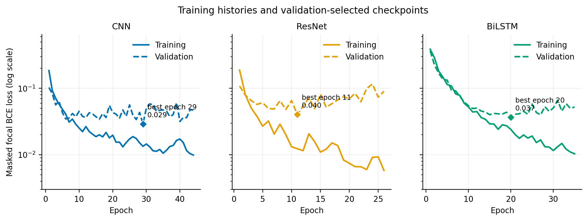

*Figure 7. Histories for the three models on the expanded corpus. Diamonds mark
the restored minimum-validation-loss epochs.*

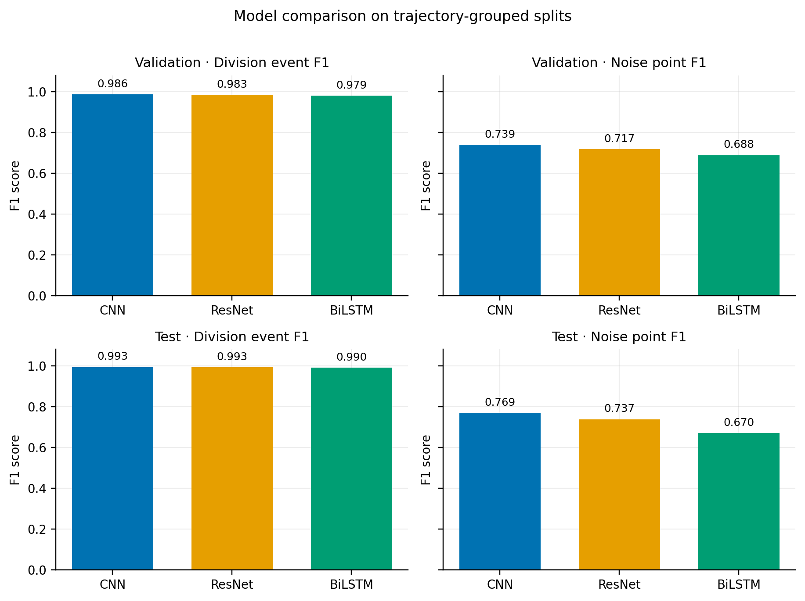

*Figure 8. Fixed-split division-event and excluded-point F1. CNN is selected
using validation results only.*

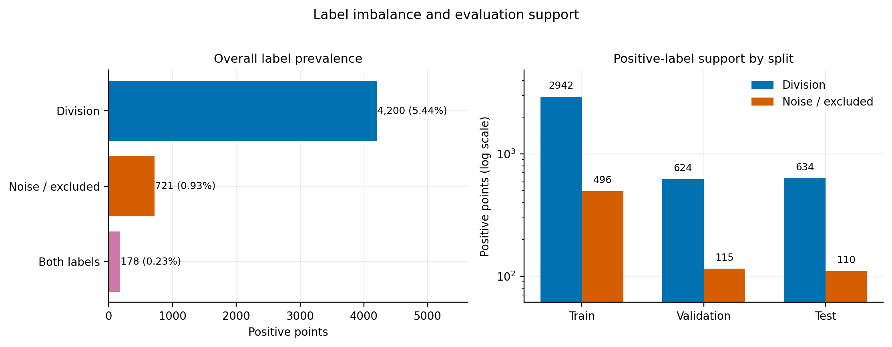

*Figure 9. Canonical-label prevalence and positive support after invalid rows and
superseded trajectories are omitted.*

For the selected CNN, source-specific evaluation is:

| Partition and source | Trajectories | Rows | Division support | Exclusion support | Division-event F1 | Exclusion F1 |
|---|---:|---:|---:|---:|---:|---:|
| Validation, 0-10 h | 72 | 10,774 | 592 | 83 | 0.992 | 0.766 |
| Validation, old-only 0-8 h | 3 | 358 | 19 | 12 | 0.941 | 0.700 |
| Validation, starvation | 2 | 600 | 13 | 20 | 0.750 | 0.629 |
| Test, 0-10 h | 72 | 10,771 | 607 | 92 | 0.995 | 0.825 |
| Test, old-only 0-8 h | 3 | 360 | 20 | 2 | 0.971 | 0.800 |
| Test, starvation | 2 | 600 | 7 | 16 | 0.933 | 0.273 |

The starvation exclusion result remains the clearest weakness: only 3 of 16
test exclusions are detected at the global threshold, and only two starvation
trajectories occur in each held-out partition. More verified starvation and
other stress-condition trajectories are therefore more valuable than increasing
model size.

CNN won the validation-only comparison and is installed at
`../trajectory_cleaning_run/best_model.pt`. Its checkpoint SHA-256 is
`f42de868a86784e65e9ee1ec0024c5f7982fce2857db035f43379b145a4f15b5`.
All dated CNN, ResNet, and BiLSTM artifacts remain under
`../trajectory_cleaning_run/verified_20260718/`. The previous deployment and
its companion artifacts were backed up under
`../trajectory_cleaning_run/promotion_backups/20260717T181236.415835Z`.

The latest test exclusion F1 is 0.769 with 110 positive points, compared with
0.596 with 24 positive points in the preceding run. Because the corpus and split
changed, this is evidence of improvement on the expanded held-out set rather
than a paired head-to-head estimate on identical trajectories.

## Production-corpus rounds (2026-09-17 to 2026-10-29)

The rounds above document the exploratory corpora of 2026-07. From 2026-09-17
onwards the model has been trained on the frozen production corpus and its
additive human-verified batches. The scientific contract, corpus provenance,
and complete round history live in `../../docs/METHODS_TRAJECTORY_CLEANING_MODEL.md`
(rounds R004-R015) and `../../datasets/manifest.json`; this section records the
model-side outcomes and the deployment decision trail.

| Round | Date | Training corpus | Rows | Trajectories | Split (train/val/test) | Validation-rule winner | Production decision |
|---|---|---|---:|---:|---|---|---|
| R004 | 2026-09-17 | `verified_20260916` production corpus (17 long-exclusion-run trajectories removed) | 312,317 | 1,053 | 356/77/77 | CNN | R004 CNN promoted 2026-09-17; superseded 2026-10-16 |
| R006 | 2026-10-13 | `verified_20261013` curated batch (unmerged at the time) | 22,890 | 35 | 25/5/5 | - | no models; merge deferred |
| R007 | 2026-10-16 | `verified_20261016` curated batch (unmerged at the time) | 31,384 | 48 | 34/7/7 | - | no models; merge deferred |
| R008 | 2026-10-16 | `verified_merged_20261016` (R004 + batches 20261013/20261016) | 365,283 | 1,134 | 793/170/171 | BiLSTM (0.8987) | user overrode the rule; R008 CNN promoted (sha256 `3e796c9e...`) |
| R009 | 2026-10-17 | `verified_20261017` curated batch | 8,757 | 16 | 12/2/2 (feasibility only) | - | no models; merged in R010 |
| R010 | 2026-10-17 | `verified_merged_20261017` (R004 + batches 20261013/20261016/20261017) | 373,440 | 1,149 | 804/172/173 | CNN (0.8987) | R010 CNN promoted 2026-10-17 (sha256 `6e7c5a58...`); previous R008 CNN backed up |
| R014 | 2026-10-29 | `verified_20261029@v1` curated batch | 25,728 | 48 | not trained standalone | - | no models; all 48 merged in R015 |
| R015 | 2026-10-29 | `verified_merged_20261029@v1` (frozen R010 + R014) | 399,168 | 1,197 | 838/179/180 | CNN (0.8886) | no promotion authorized; production R010 CNN |
| R019 | 2026-10-31 | composition of the five `reviewed_20261031_*` training-ready lineages (reviewed five-batch data) | 385,815 | 1,152 | 806/173/173 | CNN (0.9012) | R019 CNN promoted 2026-10-31 in R020 (sha256 `816a8b39...`); previous R010 CNN backed up |

R004-R008 checkpoint metrics are not reproduced here because they were trained
on different corpus versions and splits; the paired comparison below evaluates
the R008 and R010 checkpoints on identical held-out trajectories instead of
quoting incomparable per-round numbers.

### Round R010 retraining (2026-10-17)

Corpus: `datasets/verified_merged_20261017/verified_training_data.csv` -
373,440 rows / 1,149 trajectories / 32,470 `division_point` / 1,924
`excluded_point` (sha256
`7ecc9753cf02c0dfc020fd70f6b077f997799d46d4f3af3fd89d12a16eaee2bc`). It is the
R004 production corpus plus the three curated batches, with the R004
long-exclusion-run filter applied to the batches (three trajectories dropped:
`curated_20261013::FOV_121_CH_7`, `curated_20261016::FOV_53_CH_11`,
`curated_20261017::FOV_14_CH_14`). Seven acquisition sources contribute
trajectories: baseline_0_10h 477, baseline_0_8h 19, RDM-Gluc 546, starvation
11, and the three curated batches 34 + 47 + 15. The 295 division/exclusion
overlap rows are legacy R002-policy residue inside the frozen R004 corpus only;
the curated batches contribute none.

Split (seed 42, per-source stratified, complete trajectories kept together):
804 training / 172 validation / 173 test trajectories (261,377 / 55,866 /
56,197 rows; division positives 22,689 / 4,842 / 4,939; exclusion positives
1,304 / 314 / 306). Every source appears in every partition.

Training settings, architecture sizes, loss, optimizer, and threshold
calibration are unchanged from the earlier rounds (Table under "Training
properties"), so any difference between rounds is attributable to the corpus
and to optimization variance, not to a configuration change.

| Model | Parameters | Epochs (best) | Best validation loss | Division / exclusion threshold | Validation division-event F1 | Validation exclusion F1 | Validation mean F1 | Test division-event F1 | Test exclusion F1 |
|---|---:|---:|---:|---:|---:|---:|---:|---:|---:|
| **CNN** | 63,938 | 43 (28) | 0.0105 | 0.68 / 0.89 | 0.9953 | 0.8020 | **0.8987** | 0.9957 | 0.8512 |
| ResNet | 165,890 | 25 (10) | 0.0115 | 0.79 / 0.86 | 0.9962 | 0.7896 | 0.8929 | 0.9964 | 0.7973 |
| Bidirectional LSTM | 334,594 | 25 (10) | 0.0166 | 0.78 / 0.85 | 0.9946 | 0.7339 | 0.8642 | 0.9933 | 0.7993 |

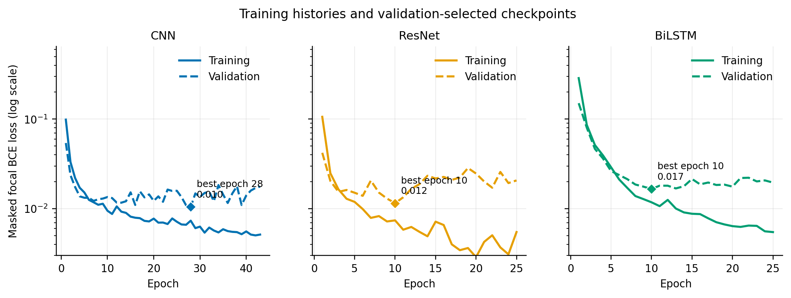

*Figure 10. R010 training histories. Diamonds mark the minimum-validation-loss
epoch restored into each checkpoint; the CNN trained for 43 epochs, ResNet and
BiLSTM stopped after 25.*

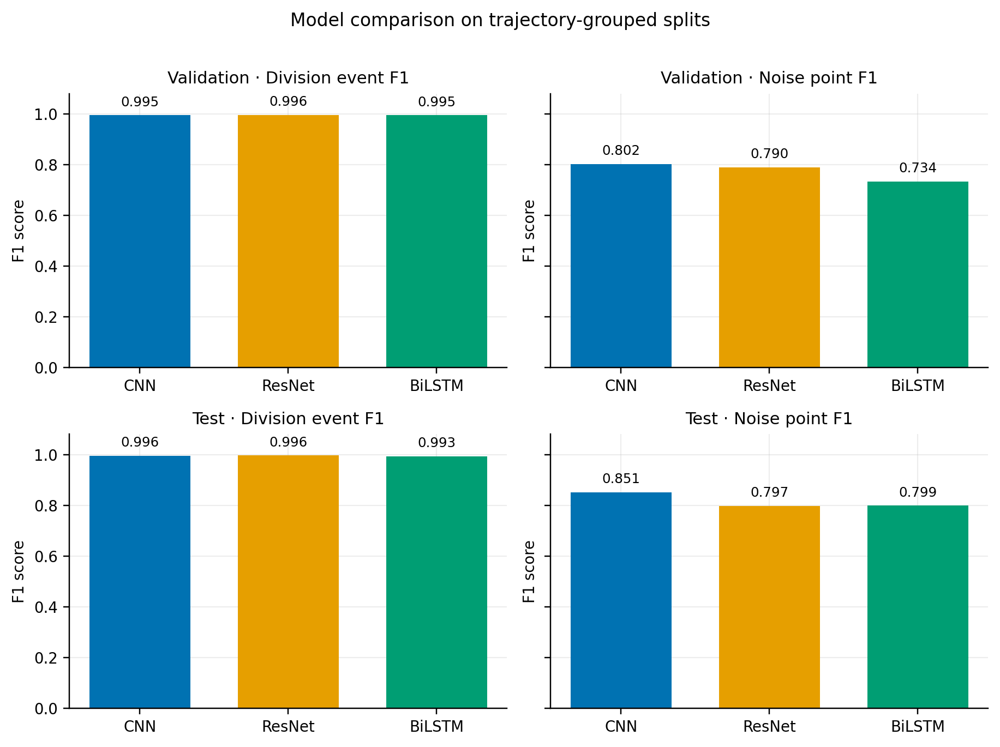

*Figure 11. R010 validation and held-out test F1 for division events and
excluded points. The CNN wins the validation-only selection rule; test metrics
do not participate in selection.*

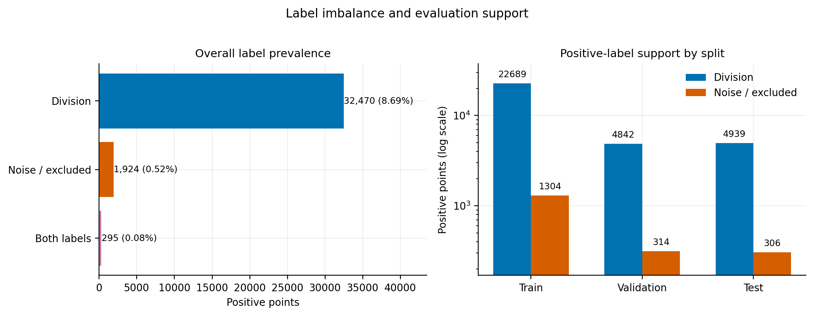

*Figure 12. Canonical-label prevalence and positive support in the R010
per-source stratified split.*

The CNN is selected by the validation-only rule. The BiLSTM's validation
exclusion F1 fell to 0.734 in this round (0.801 in R008) and it stopped at
epoch 25, whereas its test exclusion F1 (0.799) remains close to ResNet; with
a single seed this gap is not by itself evidence of a systematic LSTM
regression.

### Same-population comparison with the R008 production model

Cross-round metrics from different corpora and splits are not comparable. To
answer whether R010 is better than the deployed model, every R008 and R010
checkpoint was evaluated on two **fixed, identical test populations**:
the 173-trajectory R010 test split (56,197 rows) and the 171-trajectory R008
test split (54,780 rows). Both models see the same rows, so differences are
paired. Each checkpoint uses its own stored thresholds (deployed semantics);
average precision (AP) is threshold-free and therefore the fairer comparison
across calibration states. Reproduction check: evaluated on its own round's
test split, every checkpoint reproduces its `metrics.json` test block exactly
(all point and division-event metrics, AP to full precision), and the deployed
checkpoint is byte-identical to `runs/merged_20261016/cnn/best_model.pt`. The
R008 corpus is a subset of the R010 corpus (1,134 of 1,149 trajectories); the
two test populations share 106 trajectories.

Table 1 - evaluation on the **R010 test split** (173 trajectories; 4,939 division / 306 exclusion positives):

| Model | Division F1 | Division AP | Exclusion F1 | Exclusion AP | Division-event F1 |
|---|---:|---:|---:|---:|---:|
| R008 CNN (deployed) | 0.9943 | 0.9999 | 0.8336 | 0.8984 | 0.9962 |
| R008 ResNet | 0.9950 | 0.9999 | 0.8102 | 0.8948 | 0.9968 |
| R008 BiLSTM | 0.9956 | 0.9999 | 0.8344 | 0.9154 | 0.9972 |
| **R010 CNN** | 0.9940 | 0.9999 | **0.8512** | **0.9230** | 0.9957 |
| R010 ResNet | 0.9941 | 0.9999 | 0.7973 | 0.8841 | 0.9964 |
| R010 BiLSTM | 0.9911 | 0.9998 | 0.7993 | 0.8485 | 0.9933 |

Table 2 - evaluation on the **R008 test split** (171 trajectories; 4,814 division / 280 exclusion positives):

| Model | Division F1 | Division AP | Exclusion F1 | Exclusion AP | Division-event F1 |
|---|---:|---:|---:|---:|---:|
| R008 CNN (deployed) | 0.9953 | 0.9999 | 0.8452 | 0.8929 | 0.9970 |
| R008 ResNet | 0.9949 | 0.9999 | 0.7951 | 0.8814 | 0.9968 |
| R008 BiLSTM | 0.9954 | 0.9999 | 0.8333 | 0.9157 | 0.9971 |
| **R010 CNN** | 0.9942 | 0.9999 | **0.8641** | **0.9263** | 0.9959 |
| R010 ResNet | 0.9947 | 0.9999 | 0.8000 | 0.8836 | 0.9967 |
| R010 BiLSTM | 0.9915 | 0.9998 | 0.7978 | 0.8632 | 0.9932 |

Paired trajectory bootstrap (1,000 resamples of the test trajectories,
95% percentile CI) for the difference R010 CNN minus the deployed R008 CNN:

| Metric | R010 test split | R008 test split |
|---|---|---|
| Exclusion AP | **+0.0246 [+0.0049, +0.0489]** | **+0.0335 [+0.0120, +0.0598]** |
| Exclusion F1 (own thresholds) | +0.0176 [-0.0116, +0.0468] | +0.0189 [-0.0128, +0.0470] |
| Exclusion F1 (common 0.5 threshold) | **+0.0321 [+0.0103, +0.0561]** | **+0.0388 [+0.0184, +0.0616]** |
| Division AP | +0.00002 [-0.00001, +0.00005] | +0.00000 [-0.00000, +0.00000] |
| Division-event F1 | -0.0005 [-0.0018, +0.0012] | -0.0010 [-0.0019, -0.0003] |
| Division F1 (common 0.5 threshold) | **+0.0035 [+0.0011, +0.0066]** | +0.0017 [-0.0001, +0.0039] |

Split-overlap control. The two rounds partition the same corpus differently, so
52 of the 173 R010-test trajectories lie in the R008 training split and 56 of
the 171 R008-test trajectories lie in the R010 training split. The full-
population tables above are therefore slightly optimistic for whichever model
trained on those trajectories. The comparison was repeated on the leakage-free
subset (trajectories in neither round's training split: 121 and 115
trajectories, 33,736 / 30,809 rows, 250 / 230 exclusion positives); this subset
keeps all curated batches in the R010 test panel but
retains only 30 of the 82 RDM-Gluc test trajectories, so it over-represents the
baseline condition:

| Leakage-free subset | Model | Division F1 | Division AP | Exclusion F1 | Exclusion AP | Division-event F1 |
|---|---|---:|---:|---:|---:|---:|
| R010 test (121 traj) | R008 CNN | 0.9920 | 0.9998 | 0.8233 | 0.8830 | 0.9949 |
| | **R010 CNN** | 0.9911 | 0.9998 | **0.8430** | **0.9188** | 0.9939 |
| | R010 ResNet | 0.9916 | 0.9997 | 0.7842 | 0.8708 | 0.9950 |
| | R010 BiLSTM | 0.9875 | 0.9997 | 0.7842 | 0.8552 | 0.9903 |
| R008 test (115 traj) | R008 CNN | 0.9925 | 0.9997 | 0.8170 | 0.8683 | 0.9951 |
| | **R010 CNN** | 0.9902 | 0.9998 | **0.8349** | **0.9021** | 0.9934 |
| | R010 ResNet | 0.9914 | 0.9997 | 0.7775 | 0.8616 | 0.9949 |
| | R010 BiLSTM | 0.9876 | 0.9996 | 0.7713 | 0.8336 | 0.9901 |

On the leakage-free subsets the paired R010 CNN minus R008 CNN differences are:
exclusion AP **+0.0358 [+0.0097, +0.0646]** (R010 test) and **+0.0337
[+0.0097, +0.0606]** (R008 test); exclusion F1 +0.0197 [-0.0183, +0.0499] and
+0.0179 [-0.0188, +0.0498]; division-event F1 -0.0009 [-0.0029, +0.0015] and
-0.0016 [-0.0033, -0.0002]. The exclusion advantage is therefore not an
artifact of the differing partitions, and the division difference remains at
the 0.1-percentage-point scale. The same leakage-free panel gives R010 ResNet
exclusion AP -0.012 / -0.007 (CIs spanning zero) and R010 BiLSTM exclusion AP
-0.028 / -0.035 (CIs spanning zero) with exclusion F1 consistently lower.

**Verdict.** On the current test population, the R010 CNN is a modest but
reproducible improvement over the deployed R008 CNN on the label that matters
most for this deployment, exclusion/noise detection: threshold-free exclusion
AP improves by +0.025 (95% CI +0.005 to +0.049; 996/1,000 bootstrap resamples
positive) and by +0.034 (CI +0.012 to +0.060) on the older test population, and
the gain replicates on the leakage-free panels (+0.036 and +0.034, CIs above
zero);
with exclusion F1 up by 1.8-1.9 percentage points (not separable from zero at
each model's own threshold given only 306 / 280 exclusion positives, but
+3.2 / +3.9 points at a shared 0.5 threshold with CIs excluding zero). Division
detection is unchanged in practice: division AP is identical to four decimals
and the division-event F1 difference is -0.05 points (CI spans zero) on the
current population and -0.10 points on the older one, both still at 0.996.

R010 ResNet is not better than the deployed CNN (exclusion F1 is 3.6-4.5 points
lower, with a CI excluding zero on the older test population), and the R010 BiLSTM is
worse on both labels (-0.050 exclusion AP, -0.0029 division-event F1, CIs
excluding zero). Ranking all metrics by mean rank puts the R008 BiLSTM
marginally first (2.0 versus 3.0 for the R010 CNN), but that ordering is driven
by +0.12 points of division-event F1 while its exclusion F1 is 1.7 points lower
than the R010 CNN; it is not a better deployment trade-off for the weak label.

Caveats: single seed per round; the bootstrap treats trajectories as
independent although FOVs are shared across partitions (so the CIs are
optimistic about generalization to new FOVs); exclusion positives are few
(306 / 280 test points in the full panels, 250 / 230 in the leakage-free
panels); and the leakage-free panel under-represents the RDM-Gluc condition
(30 of 82 test trajectories retained). The direction of the exclusion
improvement is nevertheless consistent across both fixed populations, across
the full and leakage-free panels, and across thresholded and threshold-free
measures, while division detection stays at its ceiling.

**Recommendation:** promote the R010 CNN. It is the validation-rule winner of
this round, it is significantly better on exclusion discrimination with no
division regression, and it is trained on the largest verified corpus. The
R010 artifacts are `runs/merged_20261017/cnn/` (checkpoint sha256
`6e7c5a5896c90bd0de2b068af087f2d9c942b2de94e8deb87e419fd005cb230b`).
The user executed this recommendation on 2026-10-17 (round R011); production
is now the R010 CNN.

### Deployment status

The production checkpoint is the **R019 CNN**
(`src/moma_lineage_analysis/models/trajectory_cleaning_run/best_model.pt`,
sha256 `816a8b392ec206dca578a093c6cbc2fc9ec5ba12480d6aca7c8b08349796af99`),
promoted 2026-10-31 by explicit user decision (round R020) from the R019
reviewed-corpus run `runs/reviewed_20261031/cnn/` with
`python -m moma_lineage_analysis.trajectory_cleaning.promote_best_model
--run-dir runs/reviewed_20261031 --destination-dir
src/moma_lineage_analysis/models/trajectory_cleaning_run`.
The tool re-applied the validation-only rule (CNN mean F1 0.901205 vs BiLSTM
0.884530 and ResNet 0.860075; test never read), required byte-identical split
manifests, copied the four artifacts with sha256 verification, and wrote
`promotion.json`. The promoted artifacts are byte-identical to the R019 CNN
run: `history.csv` `ed01562d…`, `metrics.json` `bdd1c390…`, `splits.json`
`5fb772fc…`.

Rollback source: the previous R010 CNN (sha256
`6e7c5a5896c90bd0de2b068af087f2d9c942b2de94e8deb87e419fd005cb230b`) with its
`history.csv`, `metrics.json` and `splits.json`, plus the R010 promotion
manifest, is archived under
`src/moma_lineage_analysis/models/trajectory_cleaning_run/promotion_backups/20261030T184217.243155Z/`.
The tool does not archive the previous `promotion.json`, so the R010 manifest
was copied into that directory manually and is also kept at
`runs/reviewed_20261031/promotion_previous_R010.json`. The R019 run directory
keeps `model_comparison.json`, `production_comparison.json` (pre-promotion
comparison against the-then production R010), figures, the independent
verification and `production_promotion.json`.

The R019 same-row comparison remains descriptive single-seed context for the
user's decision: it shows higher exclusion AP on the small clean common panel
(35 trajectories / 44 exclusions) and the new-batch panel, but no significance
test and no clean large head-to-head, so the deployment decision rests on the
user's authorization, not on a test-metric claim. The R010 artifacts remain
under `runs/merged_20261017/{cnn,resnet,lstm}/` with
`r010_model_comparison.json`, figures and an independently produced
`verification_report.json`.

Post-promotion health checks: `load_checkpoint` + `predict_dataframe` on the
promoted checkpoint produced finite probabilities and coherent predictions, and
the full suite passed **430 passed / 3 skipped / 59 subtests**
(`runs/reviewed_20261031/pytest_full_post_promotion.txt`). The independent R019
verification predates the promotion; its "production unchanged" observation is
explained in `runs/reviewed_20261031/verification/NOTE_AFTER_PROMOTION.md`.

### Dataset-store training path (R012, 2026-10-17)

Round R012 changes only the training data layer; no model, metric, parameter,
corpus, or deployed checkpoint changed. The frozen corpora were consolidated into
a local SQLite dataset store (`datasets/store/lineage.sqlite3`, schema 2): six
dataset versions over 375,348 de-duplicated observations / 1,152 trajectories
(13.5 MB versus 348 MB of CSV corpora), each keeping its canonical content hash,
its legacy CSV sha256, and a byte-identical CSV export. Training reads the store
read-only by lineage id and records `dataset_lineage` (lineage ids, content refs,
canonical hashes, legacy CSV sha256, composition rows/trajectories and a
trajectory-key digest) in `metrics.json`; the legacy CSV path is retained.

Reproduction of R010 from `verified_merged_20261017@v1`
(`runs/merged_20261017_store_repro/`):

| Model | Epochs | Splits | Thresholds | Discrete metrics | Weights | Max metric delta |
|---|---:|---|---|---|---|---|
| CNN | 43 | byte-identical | identical | identical | drift <=2.71e-4 | avg. precision <=8.95e-5 |
| ResNet | 25 | byte-identical | identical | identical | bit-identical | 0 |
| BiLSTM | 25 | byte-identical | identical | identical | bit-identical | 0 |

A store-loaded frame is dtype-exact identical to the legacy CSV read and yields
byte-identical split keys (804/172/173 trajectories, 261,377 / 55,866 / 56,197
rows). The small CNN residual is run-to-run GPU nondeterminism, not the store:
a control CNN retrained from the CSV path with the same seed differs from the
archived R010 CNN by the same magnitude (weights <=2.64e-4, average precision
<=8.72e-5), while ResNet and BiLSTM reproduce bit-identically from the store.
Thresholds, discrete metrics, event counts, early-stopping epochs and split
bytes are identical in all three cases. Evidence:
`runs/merged_20261017_store_repro/reproduction_report.json`; design and phase
plan: `docs/PLAN_DATASET_STORE.md`. Production remains the R010 CNN.

### Corpus retirement (R013, 2026-10-17)

After the phase-2 sign-off the six legacy corpus CSVs were deleted and the
SQLite dataset store is now the sole training source. Nothing about the models
changed: every store export still reproduces the retired CSV byte-for-byte, and
`scripts/dataset_store.py verify` reports the retired state while re-checking the
pinned export sha256 on every run. Each retired file (sha256, size, lineage id)
and a restore command are recorded in
`datasets/store/retired_csv_manifest_20261017.json`; the training command and the
resulting metrics are unchanged (`--dataset-lineage verified_merged_20261017@v1`).

### Curated batch and expanded lineage (R014/R015, 2026-10-29)

R014 adds 48 human-curated single-trajectory exports (47 x 540 rows and
`FOV_140_CH_18` x 348): 25,728 observations, 2,609 raw division labels and
98 exclusions. Effective-label staging gives **2,562 divisions = 2,609 - 51
superseded + 4 added**, with overlap 0. Resolver statuses are 2,558 unchanged /
5 coalesced / 4 shifted / 42 needs_review, and exported effective labels match
the current packaged resolver bitwise. The maximum exclusion run is 3 frames,
so the frozen R004 rule drops none. Eight reused channel identifiers receive
`20261029_` prefixes; biological identity across acquisitions is unestablished.
No exact new measurement/payload duplicates with history were found. Raw exports
remain unchanged; QC, staged files, the rename map and attestation are retained
under `datasets/verified_20261029/`.

The new batch is `verified_20261029@v1#f3c99c422a3d` (25,728 rows / 48
trajectories). R015 extends the frozen R010 lineage with all 48 to produce
`verified_merged_20261029@v1#8decab478c80`: **399,168 rows / 1,197
trajectories / 35,032 divisions / 2,022 exclusions**, from eight source datasets.
The 295 legacy R002-policy overlap rows and the known identical-content pair
from R010 remain frozen. Full CSV hashes and provenance are recorded in
`datasets/verified_20261029/dataset_manifest.json` and
`datasets/verified_merged_20261029/merge_manifest.json`.

Training reads the new merged lineage directly from SQLite with unchanged
seed-42 defaults, source stratification, focal loss, early stopping and
validation threshold calibration. The complete per-source split is 838 training
(279,548 rows; 24,538 division / 1,376 exclusion positives), 179 validation
(59,643; 5,220 / 325) and 180 test trajectories (59,977; 5,274 / 321); all eight
sources appear in every partition. CNN/ResNet/BiLSTM artifacts are under
`runs/merged_20261029/{cnn,resnet,lstm}/`. The comparison selects the **CNN**
by the validation-only mean of division-event F1 and exclusion F1. Test metrics
are descriptive, never selection inputs. Evidence:
`runs/merged_20261029/model_comparison.json`.

| Model | Epochs (best) | Best validation loss | Division / exclusion threshold | Validation division-event F1 | Validation exclusion F1 | Validation mean F1 | Test division-event F1 | Test exclusion F1 | Test exclusion AP | Seconds |
|---|---:|---:|---:|---:|---:|---:|---:|---:|---:|---:|
| **CNN** | 40 (25) | 0.009421 | 0.74 / 0.87 | 0.9951 | 0.7821 | **0.8886** | 0.9954 | 0.8026 | 0.8779 | 33.9 |
| ResNet | 21 (6) | 0.014867 | 0.78 / 0.82 | 0.9954 | 0.7250 | 0.8602 | 0.9952 | 0.7669 | 0.8527 | 29.7 |
| BiLSTM | 23 (8) | 0.018516 | 0.75 / 0.82 | 0.9927 | 0.6719 | 0.8323 | 0.9921 | 0.7202 | 0.7237 | 541.4 |

These single-seed scores do not establish stable architecture differences.
The CNN's validation mean is lower than its R010 score, but that comparison
uses a different validation population. R015 CNN checkpoint sha256:
`9753298022805b4bc9f277d70e4da29aa8d88cac84a9575691477f332ff21687`;
the other checkpoint hashes are recorded in the comparison JSON.

#### Descriptive same-row comparison with production

`runs/merged_20261029/cross_eval_vs_production.json` compares all models on
identical rows, with each checkpoint's own validation-calibrated thresholds.
The common historical panel contains 103 trajectories / 26,092 rows (1,957
division / 212 exclusion positives) seen in neither old nor new
train/validation; content-hash overlap against either train/validation is also
empty. The new-batch panel has 7 trajectories / 3,780 rows and only 13 exclusion
positives, unseen by R010 training. These are key-grouped panels, not FOV-held-out
replication.

| Model | Common: exclusion F1 | Common: exclusion AP | Common: division-event F1 | New-batch: exclusion F1 | New-batch: exclusion AP | New-batch: division-event F1 |
|---|---:|---:|---:|---:|---:|---:|
| **R010 production CNN** | **0.8232** | **0.8999** | 0.9920 | 0.3750 | 0.4883 | 0.9859 |
| R015 CNN | 0.8099 | 0.8791 | 0.9931 | 0.4242 | 0.6273 | 0.9898 |
| R015 ResNet | 0.7653 | 0.8651 | 0.9943 | **0.5405** | 0.5521 | 0.9898 |
| R015 BiLSTM | 0.7361 | 0.7759 | 0.9897 | 0.3030 | 0.2917 | 0.9871 |

On the common historical test population, R015 CNN has lower exclusion F1/AP
than production. On the new-batch test its exclusion F1/AP is higher; ResNet
has the highest exclusion F1 there, but not the highest AP or the validation
win. **This mixed descriptive evidence does not support replacing production.**
No significance test or bootstrap interval was performed, and only 13 new-batch
exclusion positives support the second panel. Do not combine panels into a
winner or use test metrics for architecture selection.

Figures: `runs/merged_20261029/figures/` (loss histories, F1 comparison and
label balance). They report the single-seed run and do not add uncertainty.

The two redundant materialized CSVs (new batch and merge) were retired after
independent data verification, following the established SQLite-only storage
policy. The eight-entry retirement ledger at
`datasets/store/retired_csv_manifest_20261017.json` retains per-file hashes and
restore commands; `runs/audit_20261029/retirement_report.json` records
post-retirement verification PASS. Staged files, raw exports and reports stay.
The store now holds 401,076 unique observations / 1,200 trajectory keys across
eight versions and 4,680 trajectory-version memberships (14,458,880 bytes).
Independent raw auditing is `PASS_CURRENT_BATCH_WITH_WARNINGS`: the 42
`needs_review` sources are suppressed by effective policy (not new human
adjudication), and the 348-row `FOV_140_CH_18` ends earlier at 17.8540 h with
no internal gaps. A synthetic probe identifies a separate audit-decision ID
precision issue for integer IDs >2**53 outside the current batch; the boundary
tuple and current effective targets are unaffected. Raw audit evidence:
`runs/audit_20261029/raw_independent_audit.json`. The data phase passed 317
checks; full regressions passed 230 tests / 59 subtests with 4 skips
(`runs/merged_20261029/pytest_full.txt`). The final backup is
`datasets/store/backups/lineage_20261028T175033.995401Z.sqlite3.gz` (sha256
`388246cfa0299e3f1a935f0a66e4d786f383bfd41538d23b206c0d646bdbc10c`,
7,054,400 bytes; `runs/merged_20261029/store_backup.json`).

Final verification: `runs/merged_20261029/verification_report.json` is
`PASS_WITH_DOCUMENTED_CAVEATS`, with 441 recorded checks (317 data, 35
retirement, 65 training/cross-evaluation, 24 final comparison/integrity) and no
failures. The packaged retirement verification adds 18 checks. The historical
content-duplicate pair is both in R015 train. Original external R002-era source
paths are unavailable, but frozen payloads and old-version hashes pass. The
compressed backup is logically equal to the live store; physical SQLite layout
is not claimed to be byte-identical.

**Deployment:** R015 is a retraining/reporting round; no promotion is authorized.
Production remains the R010 CNN with sha256
`6e7c5a5896c90bd0de2b068af087f2d9c942b2de94e8deb87e419fd005cb230b`.

### Temporal-context schedules (R016, registered 2026-10-29)

**Status: complete and independently verified (PASS_WITH_DOCUMENTED_CAVEATS).**
All 29 runs, the locked selection, evaluation, diagnostics and figures are
finished. Both locked
contexts are **RF17**: CNN kernel-5 RF17 and primary ResNet kernel-3 RF17, which
are the *smallest* screened schedules. The protocol is
`runs/context_20261029/protocol.json` (sha256 `dc67f1ccebe956e4636ddab7708eca173e02fe0de46a24df7b86c906878bfb96`),
with environment and preservation records in the same run directory. It uses
the frozen R015 corpus and 838/179/180 split; hidden width 64 is fixed and
width tuning is deferred. Production remains the R010 CNN.

For each four-entry dilation vector, the nominal dense receptive field is
`R = 1 + 4 * sum(d)` for both kernel-5 CNN and kernel-3 primary ResNet
(the latter has two convolutions per residual block). Every integer offset is
covered (zero holes). This field is in **normalized-input frames**, not a raw
end-to-end observation window: full-trajectory normalization statistics and
phase features are unchanged.

| Family/control | Kernel / depth | Dilations | Nominal contexts | Parameters |
|---|---|---|---|---:|
| CNN primary sweep | 5 / four convolutions | one entry per layer | 17, 33, 49, 65, 97, 121, 161, 197 | 63,938 for every context |
| ResNet primary sweep | 3 / four residual blocks | each entry repeated in both convolutions | same eight contexts | 100,354 for every context |
| Original ResNet control | 5 / four residual blocks | 1, 2, 4, 8 | 121 | 165,890 |

The four-entry schedules are [1,1,1,1], [1,1,2,4], [1,2,3,6], [1,2,5,8],
[1,3,7,13], [1,3,8,18], [1,4,11,24] and [1,4,12,32], respectively.
The CNN's original RF17 is included in the primary screen. The old ResNet
kernel-5 RF121 control is excluded from the primary ResNet shortlist because
both kernel and capacity differ. `conv_dilations` is optional; existing
default configurations and checkpoints retain their old behavior.

Constant parameters within a family do not make this a pure test of temporal
context: dilation changes tap multiplicities and spacing as well as nominal
coverage, and primary ResNet kernel 3 differs from the old kernel 5. A dense
support set does not remove these confounds. Conclusions must therefore be
limited to the particular screened schedules.

#### Registered screen, repeat, and lock

1. Seed 42 trains eight CNN and eight primary-ResNet schedules, plus the
   original ResNet control. Validation all-row mean of division-event F1 and
   exclusion F1 is the primary ranking score. Tie-breakers are validation
   exclusion F1, division-event F1, minimum validation loss, then smaller RF.
2. The top three schedules per family are retrained on seeds 43 and 44 using
   the same frozen split. The same score and tie-breaks, averaged across
   seeds 42/43/44, lock one context per family **before any test evaluation**.
   There are 29 expected training runs in total. Authorized workers may train
disjoint config folders on different GPUs; this is operational parallelism,
not a protocol, data or selection change. Wall-clock results are per-device
measurements, not cross-device performance comparisons. Stalled parent
orchestrators were replaced by direct managed workers; this operational recovery
requires final verification of run completeness, identity and reproducibility
before claiming that results were unaffected.
3. Every seed 42/43/44 checkpoint for each locked winner is evaluated and
   reported; no best seed is selected. Screen/repeat artifacts, hashes and the
   selection lock must agree before evaluation starts. Independent verification
   must also re-derive the winners and check all split/source/lock pins.

The newly trained original-ResNet kernel-5 seed-42 control and the prior R015
ResNet kernel-5 seed-42 checkpoint are distinct physical runs despite sharing
nominal settings. Supplemental evaluation of the new control after locking is
planned to keep this distinction explicit; the fixed R015/R010 controls remain
separate descriptive controls.

The seed-42 shortlist is reused in the final mean, so that mean has selection
optimism. Three-seed mean/SD quantifies optimization noise, not new-dataset,
FOV or acquisition-generalization uncertainty. The grid is irregular and does
not justify an interpolated optimum; a winner is only **best among the
screened/shortlisted schedules**. Original controls have one seed and are
descriptive, not a seed-robust superiority comparison.

#### Registered diagnostics and reporting boundary

Validation contains 179 trajectories / 59,643 rows / 325 exclusion positives;
74 trajectories (41.3%) are shorter than 197 frames. The fixed common interior
(radius 98) has 28,096 rows / 147 exclusion positives. Finalists are to be
compared on that common interior versus its boundary and on trajectory-length
strata <197 versus >=197. Own-context interior populations vary by schedule and
are coverage descriptions, not matched cross-context populations. The main
selection score remains the all-row validation score. Supplementary validation
diagnostics for all 29 runs are planned in the post-lock reporting step, not
as additional selection criteria. They report point precision/recall/F1/AP at
stored thresholds and do not re-cluster division events on cropped tracks.
Zero-row cohorts are absent, not zero-valued metrics.

#### Results: locked schedules and three-seed reporting

The selection lock (`selection_lock.json`, `test_evaluated_before_lock: false`)
chose RF17 for both families. All three seeds are reported.

| Locked model | Validation mean F1 (mean ± SD over seeds 42/43/44) | Validation exclusion F1 | Validation exclusion AP | Params |
|---|---|---:|---:|---:|
| CNN kernel5 RF17 | 0.885582 ± 0.004732 | 0.776475 ± 0.009194 | 0.858204 ± 0.013067 | 63,938 |
| ResNet kernel3 RF17 | 0.887547 ± 0.006512 | 0.780466 ± 0.012591 | — | 100,354 |

Shortlisted alternatives were lower on the same validation score: CNN RF33
0.877089 ± 0.003709 and CNN RF121 0.849800 ± 0.020845. **Within these screened
schedules, the smallest context ranked highest and larger nominal contexts did
not improve validation; the irregular grid, selection optimism and single split
mean this is not evidence of a universal optimum or of a causal receptive-field
effect.** CNN RF121 also shows the largest seed spread (exclusion F1 SD 0.0414),
so apparent large-context differences are partly optimization noise.

Three-seed test means for the locked models versus fixed descriptive controls:

| Model | Test exclusion F1 | Test exclusion AP | Common historical panel exclusion AP |
|---|---:|---:|---:|
| CNN RF17 (locked, 3 seeds) | 0.7972 | 0.8659 | 0.8771 |
| ResNet kernel3 RF17 (locked, 3 seeds) | 0.8043 | 0.8759 | 0.8745 |
| R015 CNN (control, 1 seed) | 0.8026 | 0.8779 | 0.8791 |
| **R010 production CNN (control, 1 seed)** | **0.8183** | **0.8960** | **0.8999** |

**The locked context models do not outperform the deployed production CNN on
these descriptive panels, and the deployed model retains the best exclusion AP.**
No promotion is performed or recommended; the primary ResNet family also changed
kernel from the deployed kernel-5 architecture. Controls are single-seed, so no
seed-robust superiority claim is made in either direction, and no significance
test or bootstrap interval was computed.

#### Coverage, boundary and per-source diagnostics

On the matched radius-98 interior (105 trajectories, 28,096 rows, 147 exclusion
positives), the locked models score higher than on its complementary boundary
(179 trajectories, 31,547 rows, 178 positives): CNN RF17 exclusion F1
0.8380/0.8333/0.8299 interior versus 0.7375/0.7343/0.7162 boundary across seeds;
ResNet RF17 0.8671/0.8269/0.8244 versus 0.7356/0.7324/0.7259. RF17's own window
is far smaller than radius 98, so this gap reflects edge difficulty and cohort
composition, not its own coverage limit.

Nominal frames are not a constant physical window. In validation, RF17 covers a
full window in all 179 trajectories, whereas RF197 covers 105 trajectories and
47.1% of row centers. Median elapsed span is about 0.803 h for RF17 versus
9.831 h for RF197, and differs by acquisition source, so frame-indexed contexts
mix different real durations.

Per-source exclusion support is highly uneven: rdm_gluc_toggle_20260905 has 82
trajectories / 104 positives and reaches exclusion F1 0.85-0.91, while
starvation_20251111 has 2 trajectories / 15 positives with exclusion F1
0.25-0.40 and baseline_0_8h has 2 positives with values swinging 0.33-1.00
across seeds. Such tiny strata are unstable and must not be read as
source-specific performance conclusions.

#### Verification status and evidence

Evidence: `screen_results.json`, `repeat_results.json`, `selection_lock.json`,
`evaluation.json`, `summary.json`, `validation_diagnostics.json`,
`control_evaluation.json`, `figures/` with its data sidecars, and the
orchestration record. The Lead's audit reported 438 passing checks after
correcting an **audit-only** ResNet receptive-field formula (training code
unchanged), and the newly trained original-ResNet kernel-5 control was evaluated
separately from the R015 ResNet checkpoint.

Independent verification (`verification_report.json`) is
**PASS_WITH_DOCUMENTED_CAVEATS**: 21/21 checks, no failures, and 183 replay
checks on each of the two GPUs. Implementation, provenance, validation-only
selection and locked-finalist evaluation were re-derived independently. Replay
is exact for every discrete metric on the original training device; other
devices differ only in average precision and in one borderline point. Exactly
one validation probability for CNN RF17 seed 42 lies within 1e-5 of the 0.87
exclusion threshold, so replaying it elsewhere flips that single point
(precision -0.002738, F1 -0.001255). Maximum absolute AP deviation was
4.74e-05 on the original GPU, 1.07e-04 on the second GPU and 1.03e-03 on CPU.
**Compare discrete metrics on the original device and treat AP gaps of this
magnitude as numerical noise.** Production is confirmed preserved
(`promotion_performed: false`, `promotion_authorized: false`). The R015 test,
103-key historical panel and seven new-batch trajectories were all previously
reported and are descriptive, not fresh external holdouts.

## Training-dataset review app (R018, 2026-10-29)

The focused `moma-trainset-review` Streamlit app is an independent review
front-end to the SQLite dataset store. It is not a training or promotion path.
Source modules live in `src/moma_lineage_analysis/trainset_review/` and the
installed entry point is `moma-trainset-review`. The full user guide is
`docs/TRAINSET_REVIEW.md`.

**Model selection exposed to reviewers.** The shared registry
`src/moma_lineage_analysis/model_registry.py` contains the production
**R019 CNN** (sha256
`816a8b392ec206dca578a093c6cbc2fc9ec5ba12480d6aca7c8b08349796af99`, promoted
2026-10-31) and the
**R015 CNN** (sha256
`9753298022805b4bc9f277d70e4da29aa8d88cac84a9575691477f332ff21687`, trained on
`verified_merged_20261029@v1`, 399,168 observations / 1,197 trajectories, RF17).
The R015 checkpoint is packaged at
`models/trajectory_cleaning_run/merged_20261029/cnn/` with a release manifest.
It is selectable for human-reviewed previews only: R019 remains the production
default and selecting R015 does not promote or overwrite anything.

**Preview and evaluation.** Thresholds start from the selected checkpoint's
calibrated defaults and remain adjustable. Running a preview does not save
labels; applying division or exclusion suggestions is a separate explicit
action. Cached results are keyed by ordered frame content, checkpoint bytes,
device, thresholds and database revision, preventing a stale preview from being
reused after edits. Evaluation compares saved labels with predictions and shows
the checkpoint's recorded train/validation/test badge, or `unseen` when a key is
absent. Agreement on a training trajectory is a review aid, not held-out
performance, and editing labels does not create a new holdout.

**Mutation boundary.** Individual measurements (`time_h`, `spine_length`) are
not editable. Label edits autosave and apply globally to shared observations
across every referencing version. Permanent trajectory deletion removes all its
observations and memberships from the live database and has no in-app restore;
it requires exact-key confirmation and an impact display. Each edit/deletion
takes an online SQLite backup first under `review_backups/` beside the database.
Strict compare-and-swap on a global revision and a stale-view guard reject
concurrent-session overwrites.

**Working and finalized data.** A reviewed frozen version is marked working
(`frozen = 0`), its original pins/counts are preserved in review state and its
working hash/order/counts are recomputed. Training resolution refuses working
versions. Finalization creates a new frozen dataset ID with a human-attestation
checkbox, R004 filter on new membership only, source-lineage provenance and a
byte-exact native export hash; verification requires matching finalize audit,
provenance, canonical and export hashes. Historical CSV import is refused once a
store has reviewed working data, preventing deleted-trajectory resurrection.

**Implementation evidence (2026-10-29).** Final full suite: **388 passed / 4
skipped / 59 subtests** in 81.96 s
(`runs/trainset_review_implementation/pytest_full_final.txt`). Independent
verification (task-26) is **PASS with zero open defects**: backend 54, registry
25, scoped helper 86, AppTest 4 and opaque/cache 13 checks pass; launcher help
exits 0. The initial browser confirmation defect UI-DELETE-CONFIRM-001 was fixed
with an atomic form submit and re-tested in a fresh TEMP browser (wrong-key
error; exact-key delete with snapshot). Navigation callbacks, finalize
tab/selection, stale-view guard and auto/CUDA device resolution were also fixed
and re-tested. Live database and production checkpoint hashes remained
unchanged. Method 0.10.0 / R018 is accepted; no promotion occurred.

## Reviewed five-batch retraining (R019, 2026-10-31)

R019 retrains all three architectures on the user-reviewed store data after the
duplicate `verified_merged_*` dataset versions were removed and the five batch
versions were finalized as training-ready lineages. No hyperparameter changed
relative to R015/R016 defaults, so architecture comparisons remain
like-for-like.

**Corpus.** Composition of five review-finalized, frozen lineages
(`reviewed_20261031_verified_20260916_no_longruns@v1`,
`..._verified_20261013@v1`, `..._verified_20261016@v1`,
`..._verified_20261017@v1`, `..._verified_20261029@v1`):
**385,815 rows / 1,152 trajectories / 33,665 `division_point` / 1,740
`excluded_point`** (49 legacy overlap rows), eight sources, zero duplicate
observation rows. The finalization applied the R004 long-exclusion-run rule to
membership only and dropped three trajectories
(`baseline_0_10h::FOV_28_CH_2`, `curated_20261016::FOV_53_CH_11`,
`curated_20261017::FOV_14_CH_14`); no trajectory or observation was deleted
from the store. Relative to R015 the population differs: user review had
permanently removed 45 trajectories and edited labels before training.

**Split.** Per-source trajectory-grouped 70/15/15, seed 42, identical across the
three runs: **806 train / 173 validation / 173 test** trajectories
(269,699 / 58,007 / 58,109 rows; 23,499 / 5,029 / 5,137 divisions;
1,196 / 270 / 274 exclusions). The split was independently reconstructed from
the store composition and matches every `splits.json` exactly.

| Model | Params | Epochs (best) | Validation div-event F1 | Validation exclusion F1 | Validation mean F1 | Test div-event F1 | Test exclusion F1 | Test exclusion AP | Thresholds (div / exc) |
|---|---:|---:|---:|---:|---:|---:|---:|---:|---|
| CNN | 63,938 | 31 (16) | 0.996910 | 0.805501 | **0.901205** | 0.996583 | 0.797642 | 0.878254 | 0.83 / 0.86 |
| ResNet | 165,890 | 20 (5) | 0.996415 | 0.723735 | 0.860075 | 0.995809 | 0.749091 | 0.830463 | 0.71 / 0.80 |
| BiLSTM | 334,594 | 29 (14) | 0.996512 | 0.772549 | 0.884530 | 0.996189 | 0.815238 | 0.875289 | 0.75 / 0.83 |

The validation-only rule selects the **CNN** (mean F1 0.901205). Test metrics
are acceptance reporting only and were not used for selection. Wall times were
about 30 s / 29 s / 644 s on the RTX 5090. Artifacts:
`runs/reviewed_20261031/{cnn,resnet,lstm}/`,
`model_comparison.json`, `training_summary.json`, `figures/`.

**Descriptive same-row comparison with production (pre-promotion context).**
Every checkpoint used its own validation-calibrated thresholds on identical rows
(`production_comparison.json`); this is the comparison the user saw before
authorizing promotion.

| Panel | Rows / trajectories | Exclusions | R019 CNN div-event / exc F1 / exc AP | Production R010 div-event / exc F1 / exc AP |
|---|---|---:|---|---|
| Common test, unseen in both rounds | 10,317 / 35 | 44 | 0.9983 / 0.8395 / 0.9034 | 0.9948 / 0.8250 / 0.8618 |
| New 2026-10-29 batch test | 3,780 / 7 | 14 | 0.9948 / 0.7586 / 0.8654 | 0.9834 / 0.3636 / 0.4804 |
| Full R019 test (production saw 130/173 keys in train/val) | 58,109 / 173 | 274 | 0.9966 / 0.7976 / 0.8782 | 0.9934 / 0.7846 / 0.8623 |

The common-panel exclusion AP difference (+0.0416) and the new-batch difference
(+0.3850 AP on 14 positives) are descriptive single-seed numbers: the panels are
small, there is no bootstrap or significance test, and `R015_cnn` is
contaminated on every panel because its training corpus contains nearly all R019
trajectories. The full-test panel is likewise contaminated for production
(130 of 173 keys were in R010 train/validation), so it is reported for
completeness, not as a clean head-to-head. The user authorized promotion after
this report (round R020, 2026-10-31), following the validation-only rule; the
comparison is recorded here as pre-promotion context, not as a significance
claim.

**Verification.** Store verification passes with 5 WORKING + 5 database-native
versions (`runs/store_cleanup_20261031/verify_after_finalize.json`). A separate
read-only verifier re-derived the cleanup, finalization hashes/counts, R004 rule,
manifest/build consistency, split reconstruction and checkpoint metrics:
**PASS, 29/29 checks, 0 failures** (`runs/reviewed_20261031/verification/`),
with three documentation-level discrepancies (two duplicate-content pairs whose
twins straddle partitions, retained `source_file` import metadata, and CPU AP
replay drift up to 3.24e-5 with exact event/point metrics). Full pytest suite:
**429 passed / 4 skipped / 59 subtests** at round close
(`runs/reviewed_20261031/pytest_full.txt`). R020 then promoted this CNN:
production checkpoint is now sha256
`816a8b392ec206dca578a093c6cbc2fc9ec5ba12480d6aca7c8b08349796af99`; the
previous R010 CNN is in `promotion_backups/20261030T184217.243155Z/`.

## Recommended use

1. Use the promoted CNN for human-reviewed AI previews, not unattended deletion.
2. Keep probabilities in exported CSVs and manually review low-confidence points.
3. Add more diverse exclusion labels; this is likely to help more than a larger
   architecture.
4. Before treating the metrics as generalization estimates, repeat model
   selection with FOV-held-out cross-validation and report variation by fold.
5. After model selection, retrain the deployable checkpoint on all approved
   labeled trajectories.

The command-line workflow and examples are documented in
`../docs/trajectory_cleaning_model.md`.

Regenerate all report figures from the saved histories, metrics, splits, and the
training corpus. Since phase 3 the corpus CSV is retired; restore it from the
store first, then pass it explicitly:

```powershell
python scripts\dataset_store.py export --dataset verified_merged_20261017 `
    --version 1 --output datasets\verified_merged_20261017\verified_training_data.csv
python -m moma_lineage_analysis.trajectory_cleaning.plot_training_results `
    --run-dir runs\merged_20261017 `
    --input datasets\verified_merged_20261017\verified_training_data.csv `
    --output-dir runs\merged_20261017\figures
```
